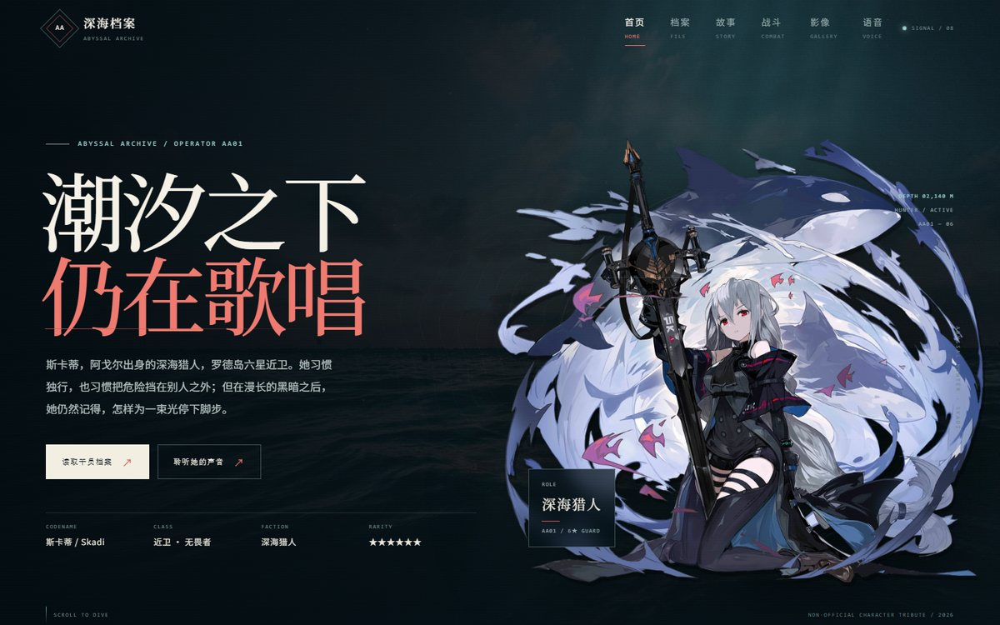
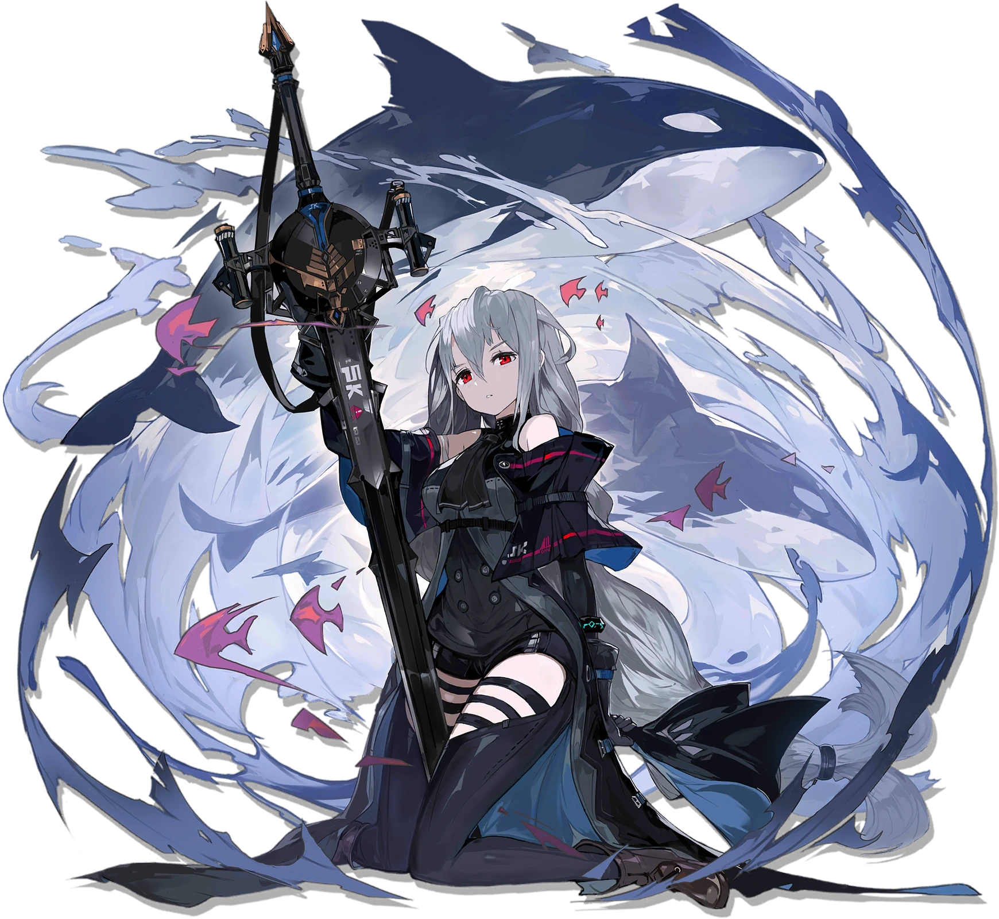

# 深海档案 · ABYSSAL ARCHIVE

一个关于《明日方舟》干员**斯卡蒂（Skadi）**的非官方角色介绍网站。以“深海档案”为视觉概念，用 HTML、CSS 与原生 JavaScript 手工搭建，适合作为网页设计课程作业或角色专题练习。

> 非官方粉丝企划，与鹰角网络 / Hypergryph 无隶属关系。角色、官方立绘与游戏内文本版权归鹰角网络所有；本站仅作非商业学习与展示。



## 一、页面结构

网站一共 **6 个内容页 + 1 个 404 页**，全部位于根目录，使用相对路径互链。

| 文件 | 页面 | 主要内容 |
| --- | --- | --- |
| `index.html` | 首页 | 首屏主视觉、角色速览、三个切面、战斗快照、影像预览、语音轮播 |
| `profile.html` | 干员档案 | 基础资料、综合体检测试、精英二属性、档案摘录、信物 |
| `story.html` | 深海回响 | 阿戈尔、赏金猎人、罗德岛、盐风城、愚人号、浊心斯卡蒂 |
| `combat.html` | 战斗手册 | 属性、三个技能、天赋、DRE-X / DRE-Y 模组、定位与培养顺序 |
| `gallery.html` | 影像档案 | 官方立绘 / 衣装 / 异格 / 印象影像，分类筛选与大图查看 |
| `voices.html` | 语音记录 | 台词轮播、按场景筛选、一键复制台词 |
| `404.html` | 404 | GitHub Pages 自定义“信号中断”页面 |

## 二、功能与技术

- **HTML5 语义化结构**：`header`、`nav`、`main`、`section`、`figure`、`blockquote`、`dialog`、`footer`。
- **CSS3**：自定义属性、Grid、Flexbox、`clamp()` 流体排版、`aspect-ratio`、混合模式、渐变与噪点纹理。
- **响应式**：桌面、平板、手机三档布局；手机端使用右侧抽屉式导航。
- **原生 JavaScript**：
  - 滚动显现（IntersectionObserver）
  - 首页 / 语音页台词轮播（可暂停、可手动切换）
  - 战斗页技能标签页（支持方向键 / Home / End）
  - 影像页与语音页分类筛选（带结果计数与 ARIA 状态）
  - 原生 `dialog` 大图查看器（上一张 / 下一张 / Esc 关闭）
  - 一键复制台词、Toast 提示
  - 返回顶部、移动端菜单、`Esc` 关闭
- **无障碍**：跳转主内容链接、可见焦点、`aria-current`、`aria-pressed`、`aria-selected`、`aria-live`、图片替代文本、`prefers-reduced-motion` 降级。
- **无框架、无构建依赖**：直接打开 `index.html` 或使用任意静态服务器即可。
- **本地字体**：Noto Serif SC 子集（仅包含页面实际使用的字符），约 363 KB，避免加载 20 MB+ 的完整中文字体。

## 三、目录

```text
.
├─ index.html
├─ profile.html
├─ story.html
├─ combat.html
├─ gallery.html
├─ voices.html
├─ 404.html
├─ assets/
│  ├─ css/style.css
│  ├─ js/main.js
│  ├─ fonts/
│  │  ├─ fonts.css
│  │  └─ noto-serif-sc.woff2
│  └─ img/
│     ├─ bg/                 # 首页深海背景
│     ├─ skadi/              # 官方立绘转 WebP、语音页头像
│     ├─ gallery/            # 影像页海报、印象图、官方视觉
│     ├─ favicon.svg
│     ├─ contour.svg
│     ├─ noise.png
│     └─ og-cover.jpg
├─ scripts/                  # 可选的素材生成 / 页面生成脚本
├─ README.md
├─ CREDITS.md
├─ GITHUB_PAGES_GUIDE.md
├─ .nojekyll
└─ .gitignore
```

## 四、本地预览

### 方法 1：直接打开

双击 `index.html`。所有页面、样式、脚本和图片均使用相对路径，不依赖服务器端程序。

### 方法 2：Python 静态服务器（推荐）

在本目录执行：

```bash
python -m http.server 8000
```

然后打开 `http://localhost:8000/`。

### 方法 3：VS Code

安装 **Live Server** 扩展，右键 `index.html` → **Open with Live Server**。

## 五、发布到 GitHub Pages

> 更完整的逐步操作、截图式说明和常见问题见 [GITHUB_PAGES_GUIDE.md](GITHUB_PAGES_GUIDE.md)。

### 准备

1. 注册 / 登录 GitHub。
2. 新建一个 **Public** 仓库，例如 `skadi-archive`。
3. 不要只上传压缩包，要把 `index.html` 和 `assets/` 等文件放在仓库根目录。

### 方式 A：网页上传（最简单）

1. 进入仓库 → **Add file** → **Upload files**。
2. 上传本项目根目录下的全部文件与文件夹（不要上传 `tmp/`、`node_modules/`、`.pnpm-store/`）。
3. 提交到 `main` 分支。
4. 进入 **Settings** → **Pages**。
5. **Build and deployment** → **Source** 选择 **Deploy from a branch**。
6. **Branch** 选择 `main`，目录选择 **/(root)**，点击 **Save**。
7. 等待 1—2 分钟，访问：
   `https://<你的用户名>.github.io/<仓库名>/`

### 方式 B：Git 命令行

```bash
git init
git add .
git commit -m "Add Skadi fan site"
git branch -M main
git remote add origin https://github.com/<你的用户名>/<仓库名>.git
git push -u origin main
```

然后在仓库 **Settings → Pages** 中选择 `main` / `(root)`。

### 为什么必须使用相对路径

GitHub Pages 的项目站点地址通常带有仓库名前缀，例如：

```text
https://username.github.io/skadi-archive/
```

如果页面里写 `/assets/style.css`，浏览器会去 `https://username.github.io/assets/style.css` 找文件，从而 404。本项目全部使用：

```html
<link rel="stylesheet" href="assets/css/style.css">
<a href="profile.html">档案</a>

```

因此无论部署在根域名还是项目子路径下，都可以正常显示。

## 六、素材与版权

详细来源见 [CREDITS.md](CREDITS.md)。

- **角色与官方立绘**：版权归鹰角网络 / Hypergryph 所有；图片取自 PRTS 明日方舟中文 Wiki，仅作非商业课程展示。
- **游戏内台词**：版权归鹰角网络所有；本页仅节选少量文本用于角色介绍与评论。
- **背景摄影**：来自 [Unsplash](https://unsplash.com/license)，遵循 Unsplash License；已进行裁剪、调色和合成，作为氛围配图使用，不代表游戏内设定。
- **字体**：Noto Serif SC，SIL Open Font License 1.1；使用 fonttools 从本机字体生成页面字符子集。
- **代码与版式**：本项目原创编写，未使用现成网页模板；借鉴了“档案 / HUD / 编辑设计”的通用视觉语言。

如果你要提交课程作业，请先确认任课教师对“使用官方角色图片”的要求；如不允许，可将 `assets/img/` 中的官方立绘替换为自绘插画或已授权的原创图片。

## 七、可修改的地方

- **主色 / 字体**：`assets/css/style.css` 顶部 `:root` 变量。
- **导航**：`scripts/build-site.py` 中的 `NAV` 数组（修改后重新运行脚本）。
- **页面文案**：`scripts/build-site.py` 中对应的 `*_BODY` 字符串，然后执行：

```bash
python scripts/build-site.py
```

- **图片**：替换 `assets/img/` 下同名文件即可；官方立绘已转为 WebP。
- **社交 / 联系方式**：本主题没有虚构个人联系方式，避免误导；如需加“关于作者”页，可在 `NAV` 中新增一项。

## 八、自查清单

- [x] 不少于 5 个页面（实际 6 个内容页 + 404）
- [x] 存在 `index.html`，且导航覆盖全部页面
- [x] 全部页面互链使用相对路径
- [x] 图文并茂，桌面 / 手机端均有完整布局
- [x] 主题正面、内容围绕角色档案与故事展开
- [x] 不依赖后端，可直接部署 GitHub Pages
- [x] 无外部字体 / JS CDN 依赖
- [x] 包含版权与素材来源说明
